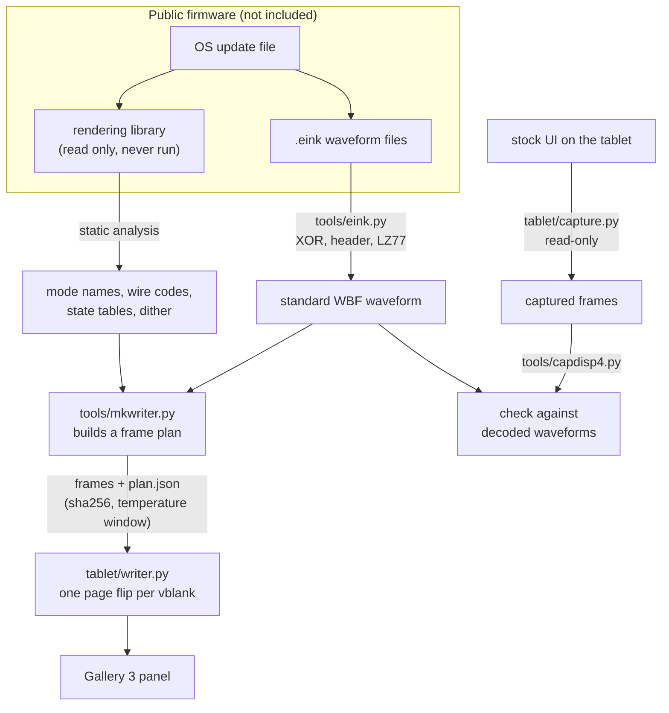

# Paper Pro display reverse engineering

Interoperability research that decodes how the reMarkable Paper Pro drives its colour e-ink panel (E Ink Gallery 3), well enough to draw on it with our own code instead of the vendor's rendering library.

**Plain-words write-up:** [AI feedback, handwritten onto a paper tablet](https://ryanwisth.github.io/paper-grader.html)

> **Unofficial research.** Not affiliated with, endorsed by or supported by reMarkable AS or E Ink Holdings. No vendor code, firmware or waveform data is distributed here; the tools read files you obtain yourself from reMarkable's public software update. Driving an e-ink panel with wrong waveforms or unbalanced drive can leave permanent ghosting or damage it. **The write path is at your own risk.** All device work was done on the author's own tablet in reMarkable's official developer mode.

## Why it exists

The Paper Pro's screen is driven by a closed user-space library. Without understanding what that library sends to the panel, there is no way to write software that draws on the display directly, test how its update modes behave, or reason about colour. This project works out the full chain, from the waveform files on disk to the bits in each scan-out frame, checks the reading against what the stock software actually sends, and then drives the panel with frames it built itself.

## How it works



## What was found

- **The waveform container is decoded.** A `.eink` file is a standard E Ink WBF file behind a byte mask, a 16-byte header and an LZ77 stream. All 314 waveform files in the OS image decode and pass their CRC-32 and header checksums. Full spec: [docs/waveform-format.md](docs/waveform-format.md).
- **9 update modes × 9 temperature bands**, each waveform a list of 32 × 32 transition tables at an 85 Hz design rate. Fast black-and-white A2 takes 11 frames (about 0.13 s); colour STANDARD takes 86 at room temperature (about 1 s).
- **Pixel geometry is solved and confirmed on the panel**: 1620 × 2160 pixels packed as 3-bit codes, 8 per 32-bit word (4 columns × 2 rows) in 405 × 1084 DRM framebuffers.
- **Colour states and dither are mapped**: 32 states per pixel, 8 inks at the corners of the RGB cube, two greys, and a dither made of a 33³ colour table blended against a 64 × 64 blue-noise matrix.
- **The kernel path is plain DRM.** The panel is fed one framebuffer per vblank; the stock UI keeps a 15-buffer ring and zeroes each buffer after display.
- **Our own frames drew on the panel**: a boot-sequence replay, a mono test card in A2, colour cards in FAST, PEN and STANDARD, a partial update with no full clear, and two grey levels.

Details and evidence level for each: [docs/display-pipeline.md](docs/display-pipeline.md).

## Features

- `.eink` → WBF decoder with integrity checks, and a WBF reader (header, mode and temperature tables, run-length bodies, phase tables).
- Per-waveform header, voltage-block and charge-balance analysis.
- Stand-alone re-implementation of the panel's colour dither, with a self-check.
- Read-only frame capture of the stock UI over DRM, a display-order rebuild of the frame ring, and a checker that identifies the update mode per pixel. Synthetic self-tests for the checker.
- A frame-plan builder (mono test card, colour card, or your own PNG; A2, STANDARD, FAST or PEN; partial updates; grey swatches) that plans every pixel's drive to net to zero or close to it.
- A tablet-side player with hash checks, a watchdog and guaranteed cleanup.
- A measured colour forward model of the panel, fitted from a photo ([docs/panel-colour-model.md](docs/panel-colour-model.md)).
- Small dependency-free readers for ext4 images, device trees and ELF files.

## Key design decisions

- **Static first, device second.** Everything that could be learned from the public update file was learned there before touching the tablet; the device was then used to confirm, not to explore.
- **Read-only before write.** The capture tool never takes control of the display. Writes came only after the decoded waveforms predicted the captured frames.
- **First write = a sequence the panel already gets at every boot.** Replaying U-Boot's developer-mode boot sequence limited the risk of the first active write.
- **No vendor code during a draw.** Frames are built off-device from the panel's own waveform file; the tablet only plays hash-checked frames.
- **Charge balance as a design input.** The erase step for colour plans was picked by computing the worst pixel's net drive over the whole run.
- **Plans are bound to a temperature band.** The runner reads the tablet's temperature and refuses a plan built for another band.

## Quick start

Requirements: Python 3.10 or later, and `pip install -r requirements.txt` (numpy and Pillow for the tools; OpenCV only for `panel-model/`). The decoders and `wfextra.py` / `dither.py` use the standard library only.

You need your own copies of the display files from the public OS update (see [docs/method.md](docs/method.md)).

```bash
# Decode a waveform container to WBF and print its header and mode tables
python3 tools/eink.py path/to/GAL3_xxx.eink out.wbf

# Phase counts per mode and band (writes panel.wbf and phase_counts.json into OUTDIR)
python3 tools/panelwf.py tools path/to/GAL3_xxx.eink OUTDIR

# Header checks, voltage blocks and charge balance for band 4
python3 tools/wfextra.py tools path/to/GAL3_xxx.eink 4

# Dither: ink mix for some RGB colours
python3 tools/dither.py path/to/libqsgepaper.so path/to/ct33_std.bin 255 0 0  128 128 128

# Build a mono test-card plan (no device needed; DISPLAY_FILES must hold libqsgepaper.so and ct33_std.bin)
DISPLAY_FILES=path/to/display-files python3 tools/mkwriter.py tools out.wbf writer/plan-testcard testcard
```

Device steps (developer mode, at your own risk; each script defaults to a read-only `dry` run):

```bash
HOST=TABLET_IP WAVEFORM=path/to/panel.eink bash run-capture.sh 120      # passive capture + check
HOST=TABLET_IP bash run-writer.sh dry 20 writer/plan-testcard             # checks only
HOST=TABLET_IP bash run-writer.sh write 20 writer/plan-testcard           # draws on the panel
```

`mkwriter.py` reads `DISPLAY_FILES` (folder holding `libqsgepaper.so` and `ct33_std.bin`, needed for every plan), `BAND`, `DRAW`, `THEN`, `GREYS` and `FONT`; see the docstring.

## Project structure

```
tools/            computer-side analysis and frame building
  eink.py           .eink -> WBF decoder, WBF header and phase reader
  panelwf.py        phase counts per mode and band
  wfextra.py        per-waveform headers, voltage blocks, charge balance
  dither.py         colour dither re-implementation
  mkwriter.py       frame-plan builder for the writer
  capcheck.py       mode check of captured pixel sequences
  capdisp4.py       display-order rebuild of a ring capture, then the check
  pswin.py          phase-shift test on one capture window
  capsynth*.py, pstest.py   synthetic self-tests
  capevents4.py, fbstat.py  capture and framebuffer inspection
  ext4r.py, fdt.py, elfr.py, xref.py   readers for ext4, device tree, ELF; table cross-reference
tablet/           device-side scripts (run as root in developer mode)
  drmlib.py, drmprobe.py, dumpfbs.py, readbench.py   read-only DRM helpers
  capture.py        passive frame capture
  replay_boot.py    boot-sequence replay (first write)
  writer.py         frame-plan player
  replay.sh, writer.sh   device wrappers that always restart the UI
run-capture.sh, run-replay.sh, run-writer.sh   computer-side runners (copy, run, fetch logs)
panel-model/      measured colour forward model: fit, measure, rectify, simulate; model.json
docs/             waveform format spec, display pipeline, method, colour model
```

## Status

**Research complete for its current scope; paused.** Verified on the device: the pixel layout, wire codes, PEN as the stroke mode, the target-keyed phase shift, the DRM write path, and the draws listed above. Verified by static analysis only: mode names, state tables, dither, charge balance. Inferred and not yet verified: the voltage per drive value, the high-temperature STANDARD → FAST switch, the dither's exact match with on-device output, and the colour accuracy of each swatch. Tested on one tablet running OS 3.27.3.0, near room temperature. Other OS versions and panel lots have not been tested. The open questions are listed in [docs/display-pipeline.md](docs/display-pipeline.md#8-still-unknown).

## How this was built

Ryan Wisth ran this project by directing AI coding agents (Claude Code). He set the goals, the safety rules (read-only first, approval before any write) and the acceptance checks, ran the device steps, and judged the results on the panel; the agents wrote most of the code and the analysis under that direction.

## License

MIT, see [LICENSE](LICENSE). reMarkable and Paper Pro are trademarks of reMarkable AS; E Ink and Gallery are trademarks of E Ink Holdings. They are used here only to identify the hardware.
